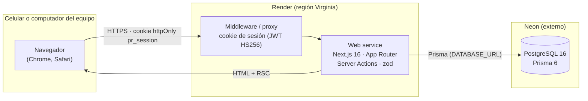

# Ficha técnica · Pulso Renacer

Web app interna de **Renacer Clínica y Spa** (Palmira, Colombia). Documento de referencia para la sustentación, el informe y
quien tome el relevo técnico. La fuente funcional es [`docs/SPEC.md`](../SPEC.md); las reglas del proyecto, en [`CLAUDE.md`](../../CLAUDE.md).

## 1. Arquitectura

- **Sin analytics, correo ni almacenamiento de archivos.** Todo vive en el servicio web y en la base de datos.
- **Base de datos en Neon (externo).** Postgres 16 en Neon (us-east-1, plan free sin expiración). `DATABASE_URL` es una variable
  secreta configurada en Render. La decisión responde a que Render permite una sola base de datos gratuita por cuenta, que ya estaba
  ocupada. Principio 6 de `CLAUDE.md`: Next.js en Render + Postgres en Neon.
- **Un solo servicio web y una sola base.** Es suficiente para menos de 10 personas. Escalar sería cambiar de plan, no reescribir.
- **Zona horaria.** La lógica de días y semanas usa `America/Bogota` (`src/lib/fechas.ts`), porque Render corre en UTC.

## 2. Stack

| Capa | Tecnología | Versión / nota |
|---|---|---|
| Framework | Next.js (App Router, TypeScript estricto, `src/`) | 16.4 |
| Interfaz | React 19 · Tailwind CSS 4 · `lucide-react` (íconos) | Componentes de servidor por defecto |
| Validación | `zod` en cada Server Action | Nunca se confía en el cliente para el rol |
| Datos | Prisma 6 · PostgreSQL 16 (Neon) | Migraciones con `prisma migrate deploy` en el build |
| Sesión | `jose` (JWT HS256) en cookie `pr_session` | 30 días, httpOnly, secure en producción |
| Fechas | `date-fns` + `@date-fns/tz` | Siempre en `America/Bogota` |
| Gráficas y QR | `recharts` · `qrcode` | Tendencias del tablero · QR de acceso |
| Pruebas | Vitest (166 pruebas unitarias) · Playwright (E2E) | CI en GitHub Actions |
| Despliegue | Render Blueprint (`render.yaml`) para la web; Neon para la base | `autoDeploy` desde `main` |

## 3. Modelo de datos

Siete tablas de registros y dos de configuración (ver `prisma/schema.prisma`):

| Tabla | Qué guarda | Qué NO guarda |
|---|---|---|
| `Consulta` (bitácora) | Rol que consulta, tipo, destinatario, respuesta, tiempo, decisor, escalamiento, reversión | Nombres de personas, texto libre |
| `Sugerencia` (buzón) | Categoría, texto (máx. 800), estado, resumen público, respuesta, publicada | Hora exacta (solo la fecha); firma cuando es anónima |
| `AvisoAgenda` (semáforo) | Color, motivo, minutos de retraso y de anticipación | Iniciales de la paciente, nombre de la cabina ni de quien avisa |
| `RespuestaPulso` / `RespuestaPulsoRoles` | Seis (o una) respuestas en escala 1–5, semana y día | Quién respondió |
| `ActaCirculo` / `Mediacion` | Cuatro campos de acta; fecha, resultado y seguimiento de la mediación | Nombres de partes, descripciones del conflicto |
| `SituacionMapa` / `Ajuste` | Contenido del mapa y parámetros (umbral, metas, cabinas, kit) | — |

Todas las tablas de registros tienen `esDemo` para separar los datos de demostración. Las lecturas que alimentan indicadores pasan por `filtroDemo()` (`src/lib/demo.ts`).

## 4. Privacidad por diseño (Ley 1581 de 2012, habeas data)

**Principios:**

1. **Mínimo dato.** No se pide ni se guarda el nombre de pacientes ni de compañeras, ni correos, ni IP, ni user-agent.
2. **Anonimato real en las sugerencias.** Sin firma, solo se guarda la fecha (sin hora).
3. **Umbral de anonimato.** Ningún promedio, porcentaje o desglose se muestra si su `n` es menor que `umbralAnonimato` (por defecto **3**, editable en Ajustes). En ese caso se muestra «Datos insuficientes para proteger el anonimato».
4. **Visibilidad.** La propietaria ve solo agregados. El equipo ve el muro y las actas; nadie ve resultados individuales del pulso.
5. **Honestidad.** Con `DEMO_MODE=true` hay un banner fijo «Datos de demostración».

**Lo que no se guarda, con su mecanismo:**

| Dato | Cómo se evita |
|---|---|
| Iniciales de la paciente (semáforo) | Solo se usan para armar el mensaje en el navegador; la acción de registro no las recibe |
| Firma de la sugerencia | Se borra del CSV de sugerencias (`/gestion/exportar`) |
| Quién respondió el pulso | No hay usuario asociado; la cookie «ya respondí» solo guarda la semana |
| IP en el ingreso | Límite de 5 intentos cada 10 min se guarda **en memoria**, sin persistir la IP |

**Conservación.** Los datos se conservan hasta el cierre del piloto o lo que defina la organización. La eliminación se pide a la administración; los datos demo se borran desde Ajustes.

**Aviso.** La primera vez se muestra un resumen del aviso de privacidad con enlace a `/privacidad`.

## 5. Costos

| Componente | Piloto | Producción |
|---|---|---|
| Web en Render | Plan *free*: **US$0** (se duerme sin tráfico) | Plan *Starter*: **US$7/mes** |
| Base de datos en Neon | Plan *free*: **US$0** (us-east-1, sin expiración) | Plan *free* de Neon mientras quepa en su límite gratis |
| Almacenamiento de archivos | No se usa | No se usa |

**Total:** piloto **US$0**; producción **≈ US$7/mes** (Render Starter) más Neon free, mientras los datos quepan en su límite gratuito.
Si el volumen lo supera, el costo de Neon depende de su plan de pago; revisar antes de llegar al límite.

Los precios son los de Render y Neon al momento de redactar este documento. Verificarlos antes de contratar.

**Recomendación:** exportar los CSV de `/gestion/exportar` cada periodo, como copia de seguridad fuera de la base de datos.

## 6. Plan de sostenibilidad

- **Quién administra.** La administradora es la responsable operativa (ingreso de códigos, mapa, bandeja del buzón, actas). La propietaria es la responsable de los datos. Una persona de respaldo técnico debe tener acceso al panel de Render y a la cuenta de Neon.
- **Cómo se cambian los códigos.** `TEAM_CODE` (equipo) y `ADMIN_CODE` (gestión) están en las variables de entorno de Render (`sync: false`, no van en el repositorio). Se cambian en *Environment* del servicio. Cambiar un código no cierra las sesiones ya abiertas; si se necesita cerrarlas todas, se cambia `SESSION_SECRET`.
- **Cómo se exportan los datos.** `/gestion/exportar` descarga cada tabla en CSV con BOM UTF-8 (abre bien en Excel). Las sugerencias salen sin firma.
- **La salida digna.** Si el proyecto termina, los CSV se abren en **Google Sheets** (o Excel) y el equipo conserva su historial sin depender de la app. La app se puede apagar sin perder la información exportada.
- **Actualizaciones.** Cada push a `main` despliega solo (`autoDeploy`). Antes de publicar, el CI debe pasar (lint, typecheck, pruebas, build).

## 7. Riesgos técnicos y mitigación

| Riesgo | Probabilidad / impacto | Mitigación |
|---|---|---|
| El plan gratis de Render se duerme tras inactividad y la primera carga tarda | Alta / bajo | Abrir la app 5 minutos antes de usarla (ver `GUION-DEMO.md`), o pasar a Starter (US$7/mes) |
| El límite del plan gratis de Neon se supera y la base deja de aceptar escrituras | Baja / alto | Exportar CSV periódicamente; vigilar el uso en el panel de Neon |
| La base vive fuera de Render y su configuración depende de una variable manual | Media / medio | `DATABASE_URL` en *Environment* de Render (variable secreta); documentar quién tiene acceso a ambas cuentas |
| Un solo servicio: si cae, la app no responde | Baja / medio | Health check en `/api/health`; el equipo puede usar WhatsApp y la agenda como respaldo |
| Código de ingreso compartido: cualquiera con el código entra | Media / medio | Es una decisión de diseño (no hay cuentas). Cambiar el código si alguien deja el equipo |
| El límite de intentos de ingreso se pierde al reiniciar el servicio | Baja / bajo | Aceptado para un equipo de menos de 10 personas: un reinicio solo permite nuevos intentos, no da acceso |
| Errores de migración en el despliegue | Baja / alto | `prisma migrate deploy` corre en el build; revisar el log de Render tras cada push |
| Datos demo mezclados con reales en un indicador | Baja / alto | Todas las lecturas pasan por `filtroDemo()`; `DEMO_MODE=false` en producción |
| Dependencia de un navegador antiguo | Baja / bajo | Diseño mobile-first con estándares actuales; se prueba a 360 px y 390 px |

## 8. Operación y pruebas

- **Local:** `docker compose up -d` y `bash scripts/db-local.sh <nombre>` crean la BD, migran y siembran datos de demo.
- **Comandos de calidad:** `npm run lint`, `npm run typecheck`, `npm test`, `npm run build`.
- **E2E:** `npm run e2e` (Playwright) contra `npm run build && npm start` con la BD local. Recorre los dos roles en 390 × 844 y toma las capturas de `docs/capturas/`. En CI es un job **opcional y no bloqueante**.
