# Manual de uso · Pulso Renacer

Para el **equipo** (recepción, cabinas, prestadoras) y para **gestión** (administración, secretaría y propietaria).
Pulso Renacer no reemplaza WhatsApp ni la agenda del spa: sirve para saber a quién acudir, avisar retrasos con un mensaje estándar,
registrar consultas, ver qué hicimos con cada propuesta, responder un pulso anónimo y ver los indicadores del piloto.

## Guía de 5 minutos para empezar

1. **Abre la app** en el celular en **https://pulso-renacer.onrender.com**, o escanea el código QR de acceso (`docs/entrega/qr-acceso.png`). La primera carga puede tardar un poco porque el servicio gratuito se duerme cuando no se usa.
2. **Ingresa con el código** que te dio la administración. Es el código del equipo (o el de gestión, si te toca).
3. **Lee el aviso de privacidad** y toca **«Entendido»**. No pedimos tu nombre, tu correo ni tu IP.
4. **Prueba con un caso real:** toca **¿A quién acudo?**, escribe una palabra (por ejemplo «turno») y abre la tarjeta.
5. **Guarda la app en tu pantalla de inicio** (en Chrome: menú ⋮ → «Añadir a la pantalla de inicio»; en Safari: Compartir → «Añadir a inicio»).

Con eso ya sabes lo básico. Lo demás lo aprendes cuando lo necesites: cada pantalla tiene su propia guía en **Más → Ayuda**.

---

## Para el equipo

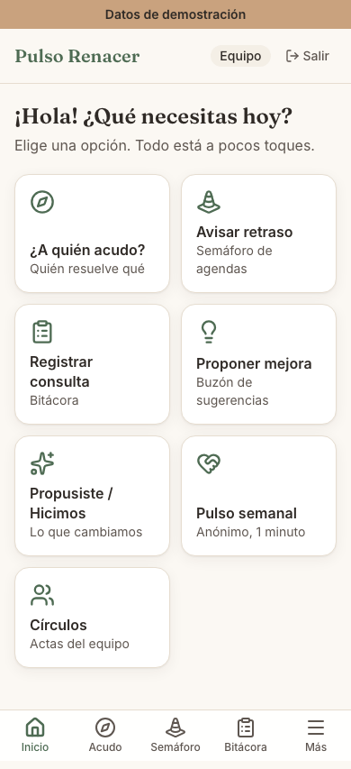

La barra de abajo siempre está a la vista: **Inicio · Acudo · Semáforo · Bitácora · Más**.

### ¿A quién acudo?

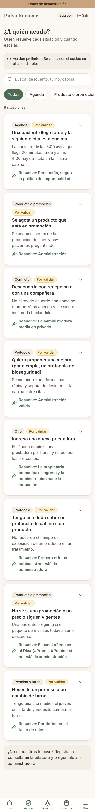

1. Entra a **¿A quién acudo?** cuando tengas una duda y no sepas quién la resuelve.
2. Escribe unas palabras en el buscador (por ejemplo «descuento» o «turno») o toca un tipo de situación para filtrar.
3. Toca la tarjeta: verás **quién resuelve**, en cuánto tiempo y **cuándo conviene escalar** a la propietaria.
4. Si no encuentras tu caso, registra la consulta en la bitácora y pregúntale a la administradora.
5. Si ves el aviso **«Versión preliminar»**, el mapa aún se está validando con el equipo en el taller de roles.

### Semáforo de agendas (avisar un retraso)

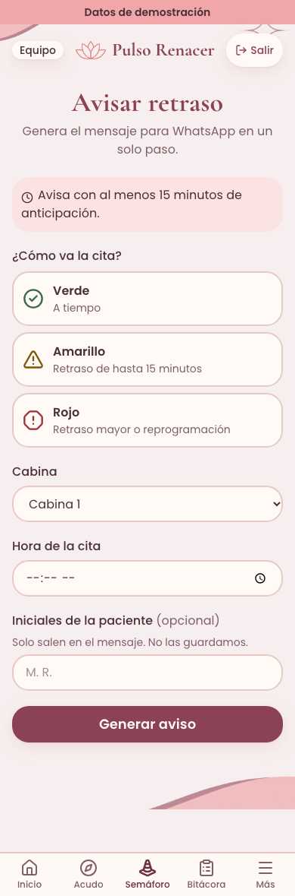

1. Entra a **Avisar retraso** cuando una cita se vaya a atrasar o cambiar.
2. Elige el color: **verde** si va a tiempo, **amarillo** si el retraso es de hasta 15 minutos, **rojo** si es mayor o hay que reprogramar.
3. Elige la cabina y la hora de la cita. Si es amarillo o rojo, escribe cuántos minutos de retraso, el motivo y lo que propones.
4. Las **iniciales** de la paciente son opcionales: solo salen en el mensaje y **no se guardan**.
5. Toca **«Generar aviso»**, revisa el mensaje y toca **«Copiar»** o **«Enviar por WhatsApp»**. Cualquiera de los dos deja registrado el aviso, sin datos de la paciente.
6. Avisa con **al menos 15 minutos de anticipación**. Si es menos, verás un recordatorio amable para coordinar mejor.

### Bitácora de consultas

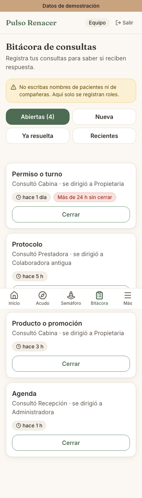

La bitácora sirve para saber qué dudas llegan, a quién se las hacen y si reciben respuesta. **No es para evaluar a nadie.**

1. **No escribas nombres** de pacientes ni de compañeras. Aquí solo se registran roles (Cabina, Recepción, Prestadora…).
2. Para registrar una consulta, entra a **Nueva** y toca tres veces: quién consulta, sobre qué es y a quién se dirigió. Se guarda sola al tercer toque.
3. En **Abiertas** ves las consultas que aún no tienen cierre. Si pasan de 24 horas aparece un aviso rojo.
4. Cuando se resuelva, toca **Cerrar** y responde: si recibió respuesta, quién decidió finalmente y si se escaló a la propietaria (y por qué).
5. Si olvidaste registrar una consulta que ya se resolvió, usa **Ya resuelta**. Puedes registrar hasta 14 días atrás.
6. En **Recientes** ves lo cerrado en los últimos 30 días.

### Buzón «Propusiste / Hicimos»

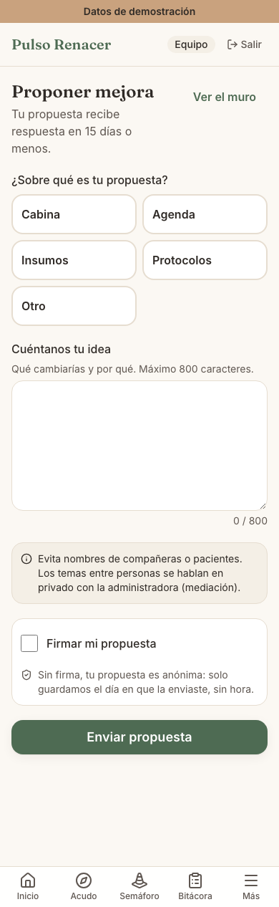

1. Entra a **Proponer mejora**, elige el tema y cuéntanos tu idea (hasta 800 caracteres).
2. Si quieres, activa **«Firmar mi propuesta»** y escribe tu nombre. Sin firma, tu propuesta es anónima y solo guardamos el día.
3. Evita nombres de compañeras o pacientes. Si es un tema entre personas, habla en privado con la administradora (mediación).
4. Al enviar verás la **fecha límite**: te respondemos en **15 días o menos**.
5. En **Propusiste / Hicimos** ves lo que se propuso y lo que hicimos con cada idea. Allí nunca aparece el texto original ni la firma.

### Muro «Propusiste / Hicimos»

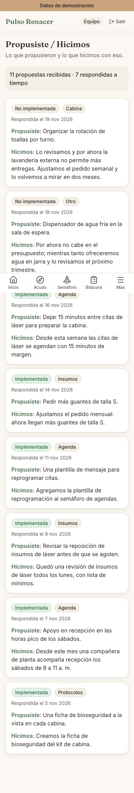

Es la vitrina de las respuestas publicadas. Cada tarjeta muestra la propuesta resumida, lo que hicimos y la fecha de respuesta.

### Pulso semanal

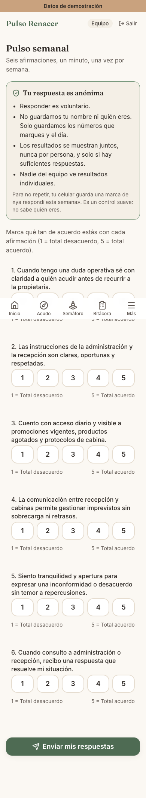

1. Entra a **Pulso semanal** una vez por semana. Toma cerca de un minuto.
2. Lee el aviso de arriba: responder es **voluntario y anónimo**. No guardamos tu nombre, solo los números y el día.
3. Marca del 1 al 5 qué tan de acuerdo estás con cada afirmación (1 = total desacuerdo, 5 = total acuerdo). Todas son obligatorias.
4. Toca **«Enviar mis respuestas»**. No se muestran resultados individuales.
5. Si ya respondiste esa semana, la app te lo dice y te muestra cuándo volver (el próximo lunes).

### Círculos de bienestar

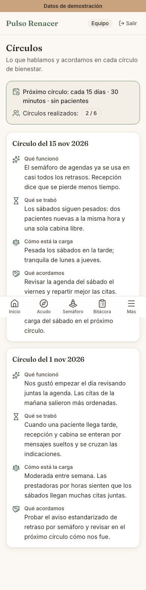

1. Entra a **Círculos** para leer las actas, de la más reciente a la más antigua.
2. Cada acta tiene cuatro partes: qué funcionó, qué se trabó, cómo está la carga y qué acordamos.
3. El círculo es **cada 15 días, dura 30 minutos y es sin pacientes**. Arriba ves cuántos círculos llevamos frente a la meta.

### Ayuda

Toca **Más → Ayuda** para ver estas mismas instrucciones dentro de la app.

---

## Para gestión

Gestión entra con el código de gestión y ve todo lo del equipo, más lo siguiente.

### Bandeja del buzón

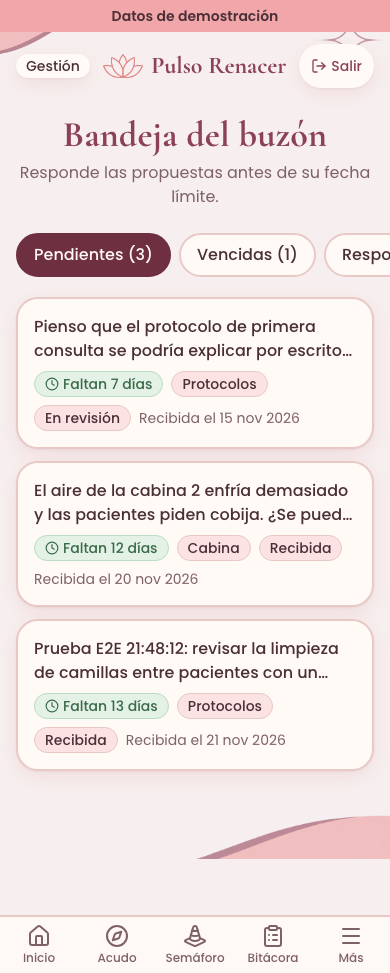

1. Abre **Gestión → Buzón**. Las propuestas salen ordenadas por **fecha límite**, con cuenta regresiva: verde (faltan más de 5 días), amarillo (5 o menos) y rojo (vencida).
2. Abre una propuesta, cambia el **estado** y escribe el **resumen público**: parafraseado, sin datos que identifiquen a nadie. Es lo que se lee en «Propusiste».
3. Escribe la **respuesta** («Hicimos»): lo que hicimos o por qué no.
4. Activa **«Publicar en el muro»** si quieres que aparezca. Toca **Guardar**: la fecha de respuesta queda registrada y el contador de pendientes en Inicio se actualiza.

### Mapa de decisiones

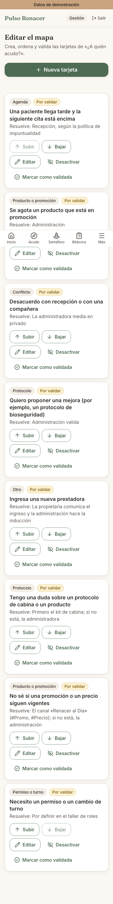

En **Gestión → Mapa** puedes crear y editar las tarjetas, subirlas o bajarlas, desactivarlas y marcarlas como validadas.

### Círculos y mediaciones

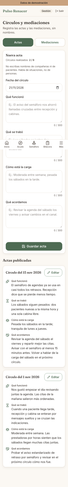

- **Actas:** llena los cuatro campos (máximo 300 caracteres cada uno) y guarda. Puedes editar un acta con «Editar».
- **Mediaciones:** registra solo la fecha y el resultado. **No escribas nombres ni descripciones.** Marca el seguimiento a la semana cuando corresponda.
- Al lado hay una guía de 5 pasos con casillas. Lo que marques no se guarda.
- Si el conflicto involucra a la administradora, media la propietaria.

### Pulso de roles

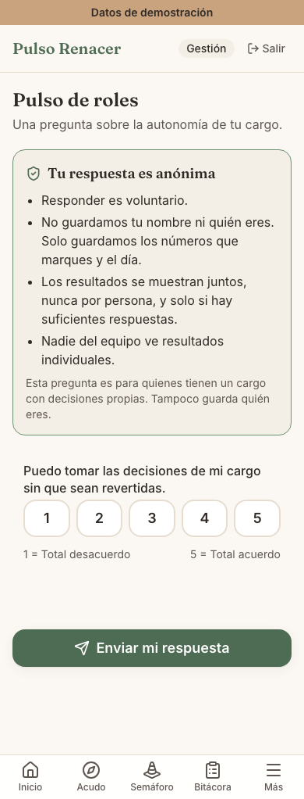

Es una pregunta adicional sobre la autonomía del cargo, con el mismo cuidado por el anonimato.

### Tablero de indicadores

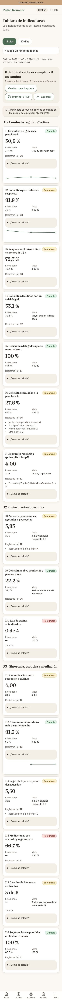

1. Entra a **Gestión → Tablero**. Arriba eliges el periodo: 14 días, 30 días o un rango de fechas.
2. Arriba ves el resumen: cuántos de los 16 indicadores **cumplen** y cuántos van **en camino**.
3. Cada tarjeta muestra el valor del periodo, el de la **línea base**, la **meta** y un estado:
   - **Cumple:** ya alcanzó la meta.
   - **En camino:** mejoró frente a la línea base, pero aún no llega.
   - **No cumple:** no ha mejorado.
   - **Datos insuficientes:** hay muy pocos registros para mostrar el dato.
4. Toca **«¿Cómo se calcula?»** en cualquier tarjeta para ver la fórmula en palabras simples.
5. Ningún dato se muestra si viene de menos de **3 registros** (o del mínimo que definas en Ajustes).
6. **Imprimir / PDF** abre una versión limpia para anexar al informe. **Exportar** descarga las tablas en CSV para Excel; las sugerencias salen sin firma.

### Ajustes

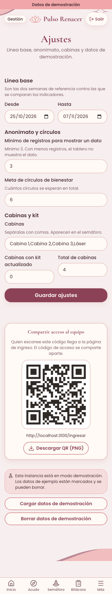

En **Ajustes** cambias las fechas de la línea base, el mínimo de anonimato, la meta de círculos, las cabinas y el kit de cabina. También está el **QR de acceso** para compartir la app con el equipo: no incluye ningún código. Si el modo demostración está activo, aquí puedes cargar o borrar los datos de demostración.

---

## Preguntas frecuentes

**¿Alguien puede ver quién escribió una propuesta o quién respondió el pulso?**
No. Las propuestas anónimas solo guardan el día, sin hora ni nombre. El pulso no guarda quién respondió. La propietaria ve solo datos agregados.

**¿Por qué a veces dice «Datos insuficientes»?**
Para proteger el anonimato, ningún promedio ni porcentaje se muestra si viene de menos de 3 respuestas o registros.

**¿Puedo escribir el nombre de una paciente en la bitácora o en una propuesta?**
No. Usa solo roles y temas. Si es un tema entre personas, va a mediación con la administradora.

**Toqué «Copiar» en un aviso y no sé si quedó registrado.**
Sí quedó: al copiar o enviar por WhatsApp se registra el aviso, sin datos de la paciente. Verás el mensaje «Listo, quedó registrado el aviso.»

**La app tarda en abrir la primera vez.**
Es normal en el plan gratuito: el servicio se duerme cuando no se usa. Ábrela unos minutos antes de necesitarla.

**Ya respondí el pulso y quiero cambiar mi respuesta.**
No se puede: se responde una vez por semana. Puedes volver el próximo lunes.

**¿Qué pasa si se me olvida cerrar una consulta?**
Después de 24 horas aparece un aviso rojo «Más de 24 h sin cerrar». Ciérrala cuando puedas; el tablero cuenta las que siguen abiertas como sin respuesta.

**¿Dónde veo las instrucciones de cada pantalla?**
En **Más → Ayuda**, dentro de la app.
